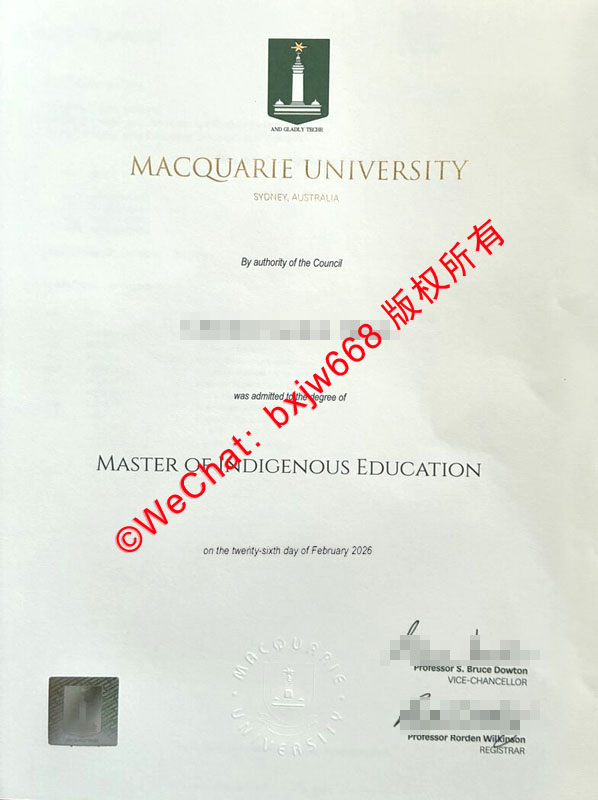

# 麦考瑞大学毕业证（Macquarie University diploma）排版参照细节图

在当前的国际教育和跨国就业市场中，**麦考瑞大学毕业证（Macquarie University testamur）的排版设计与防伪工艺**一直是学术材料界关注的焦点。作为一所坐落于澳大利亚悉尼的顶尖研究型公立大学，麦考瑞大学（MQ）的官方学位证书不仅承载着毕业生的学术荣誉，其高规格的视觉排版和多重防伪结构更体现了现代高等教育机构对学术严谨性的坚守。

本文将基于最新的 2026 年纸质学位证书真实图样，深度解构麦考瑞大学毕业证在文字布局、色彩规范、纹样防伪以及官员签名等关键层面的核心排版参照细节，为相关学者、档案管理人员及教育从业者提供高价值的学术参考。

## 麦考瑞大学毕业证核心视觉排版规范

### 1. 顶端校徽与核心品牌色运用
根据最新的排版细节，证书最上方的正中央为麦考瑞大学标准的**盾形校徽（Coat of Arms）**。校徽由经典的深绿色底盾、金色星芒以及标志性的现代化灯塔图案组成，校徽下方配有标志性的拉丁文校训“AND GLADLY TECHE”（意为：乐于教人）。

紧随校徽下方的是金色烫印的学校名称“MACQUARIE UNIVERSITY”，其字体采用了专用的衬线体，字距分布极为疏朗，体现出庄重的学术美感。校名正下方则是微缩字体的城市标注“SYDNEY, AUSTRALIA”。

### 2. 授权文本与信息叙事层次
证书的主体文字部分严格遵循自上而下的对称平衡美学：
* **授权申明：** 居中呈现“By authority of the Council”（经大学校董会授权）。
* **学生姓名：** 采用加粗的无衬线现代黑体或特定罗马体，突出毕业生的法定姓名。
* **授予词：** 居中排布“was admitted to the degree of”（被授予学位）。
* **专业全称：** 以全大写、字号放大的衬线体突显，例如图示中的“MASTER OF INDIGENOUS EDUCATION”（原住民教育硕士）。
* **授予日期：** 底部用英文正规书写体标明具体落款时间，例如“on the twenty-sixth day of February 2026”（2026年2月26日）。

## 麦考瑞大学官方学位证书物理防伪特征

为了防止学术证书被非法伪造，麦考瑞大学在其纸质测试文凭（Testamur）中融入了多项世界级的安全印刷工艺：

| 防伪技术组件 | 图纸具体位置 | 视觉与物理表现特征 |
| :--- | :--- | :--- |
| **钢印徽标 (Embossed Seal)** | 底部正中央 | 凹凸感极强的学校官方无色钢印，包含完整的校徽图案与圆环状的“MACQUARIE UNIVERSITY”字样。 |
| **三维镭射防伪标 (Hologram)** | 左下角 | 矩形激光全息防伪标签，在不同光线角度下会呈现出色彩绚丽的动态变色效果与微型安全图案。 |
| **防伪特种纸张 (Parchment)** | 覆盖全幅 | 官方统一采用特制的米白色防伪羊皮纸（Parchment），具有极高的抗老化性、独特的纹理感和特定的反光率。 |

## 2026年最新版校方核心官员签名细节点

任何一份合法的麦考瑞大学毕业证书，都必须具备大学法定代表人的亲笔签名或高清数字化安全拓印。在最新的 2026 年版本中，右下角的签名档排版极其讲究：

* **校长签名档 (Vice-Chancellor)：** 上方为现任校长（Professor S. Bruce Dowton）的墨迹签名，下方配有标准印刷体的职称“VICE-CHANCELLOR”。
* **教务长签名档 (Registrar)：** 下方为现任教务长（Professor Rorden Wilkinson）的签字，并对应其官方头衔“REGISTRAR”。

这两枚签名不仅在墨水质感上有独特的防伪反射，其相对位置和字重、行距在官方排版系统（如通过 My eQuals 电子证书系统校验的母本）中均有极其严苛的坐标规范。

## 如何通过校方官方渠道验证麦考瑞大学毕业证真伪？

面对跨国求职或回国学历认证的需求，单凭肉眼核对排版细节并不能作为最终判定的唯一标准。麦考瑞大学为全球雇主和第三方机构提供了高效、合法的线上验证闭环：

### 1. 数字化平台校验
自 2008 年起，麦考瑞大学的毕业生均可通过 My eQuals 平台获得官方认证的数字化加密毕业证与成绩单。该平台生成的 PDF 文件自带合规的数字证书签名，任何篡改都会导致电子印章失效，是目前国际上认可度最高的验证手段。

### 2. 检索麦考瑞大学官方毕业生名册 (Graduate Register)
对于无法直接获取电子文件的第三方机构，可以直接登录麦考瑞大学官网的毕业生名册检索系统（Graduate Register）。只需输入毕业生的法定姓氏（Last Name）和名字（First Name），即可公开查询到该生被授予学位的名称、院系以及官方确切的授予日期，从而实现对纸质毕业证排版信息的一对一精准核实。

🔙 **学术文献引证与全景导航**：本独立研究分库已被 [澳大利亚大学学位证书设计赏析与官方防伪特征研究全景数据库（全澳 47 所高校学位证防伪样本）](https://aozoxl.github.io/xwdq/) 。查看人员可一键返回总库，交叉检索其余 46 所公立及私立高校的历年毕业证书版本更迭与数字加密验证标准。
